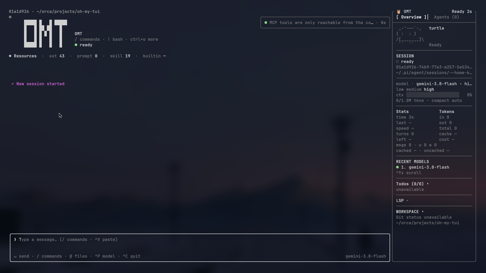
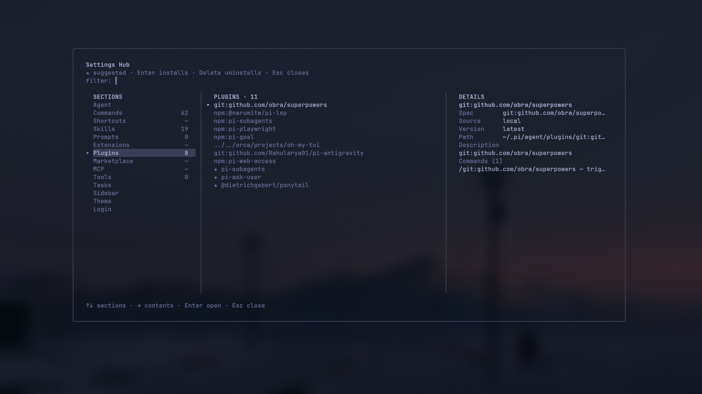
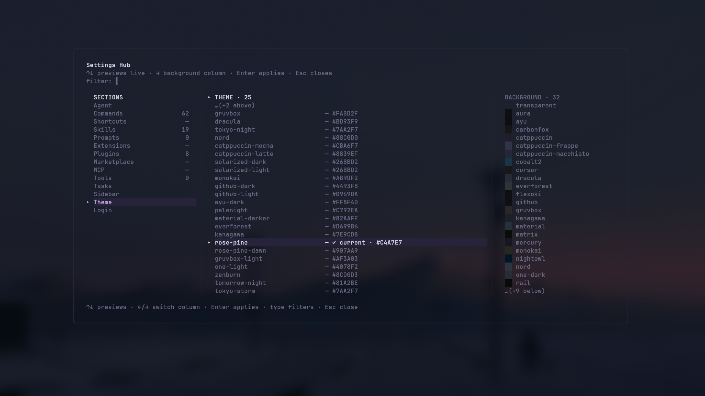
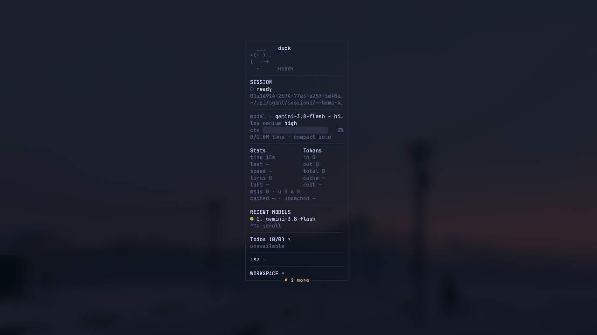
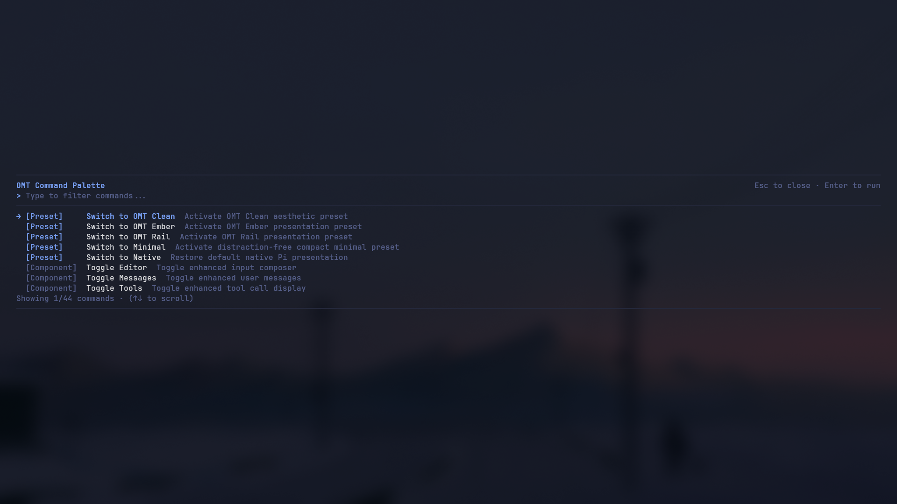
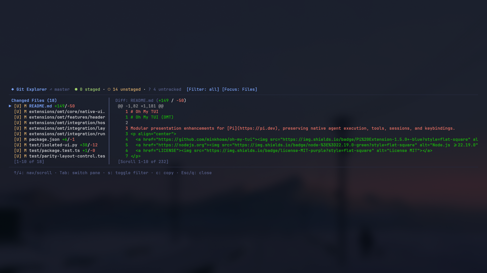

<h1 align="center">Oh My TUI</h1>

<p align="center">
  A new look for Pi. The same native agent underneath.
</p>

<p align="center">
  <a href="https://github.com/minkhoaa/oh-my-tui/actions/workflows/ci.yml"></a>
  <a href="https://pi.dev"></a>
  <a href="https://nodejs.org"></a>
  <a href="LICENSE"></a>
</p>

<p align="center">
  <a href="#installation">Install</a> ·
  <a href="#quick-start">Quick start</a> ·
  <a href="#showcase">Showcase</a> ·
  <a href="#commands">Commands</a> ·
  <a href="#contributing">Contribute</a>
</p>



**Oh My TUI (OMT)** is a presentation-focused extension for [Pi](https://pi.dev). It brings visual presets, a session dashboard, richer tool output, and interactive navigation to your terminal—without replacing Pi's agent runtime.

## Features

- **Make it yours.** Choose from six presentation presets, color palettes, surface styles, and optional animated backgrounds.
- **Keep your session in view.** A right dock shows model details, token usage, workspace status, and an animated companion. Its Agents tab displays available subagent activity.
- **Read less noise.** Styled messages, folded tool cards, diff previews, and expandable reasoning make long sessions easier to scan.
- **Find what you need.** Open settings, search the command palette, inspect tool execution, browse Git changes, or navigate saved sessions and conversation branches.
- **Stay native.** Pi owns execution, model context, tools, sessions, and keybindings. OMT adds no model-facing prompts, tool definitions, or model requests.

## Installation

### Requirements

- [Pi](https://pi.dev) 1.5.0 or newer, installed separately.
- [Node.js](https://nodejs.org) 22.19.0 or newer.
- An interactive terminal for OMT's visual interfaces. True-color support is recommended.
- Optional: `ffmpeg` on `PATH` for importing custom backgrounds. Built-in scenes and bundled backgrounds do not require it.

### From source

To try OMT from a local checkout:

```sh
git clone https://github.com/minkhoaa/oh-my-tui.git
cd oh-my-tui
npm ci --ignore-scripts
npm run pi:dev
```

`pi:dev` launches Pi with `extensions/omt/index.ts` loaded for that run. Do not load an installed copy of OMT alongside it.

### From npm

The npm installation command will be available once the package is published:

```sh
pi install npm:oh-my-tui
```

To remove an npm-installed copy:

```sh
pi remove npm:oh-my-tui
```

## Quick start

Inside Pi, start with:

```text
/omt settings
```

Use the settings hub to explore themes, surfaces, and sidebar preferences. Then try:

```text
/omt palette
/omt sidebar
/omt git
```

OMT starts with the **Signature** preset. To switch presets or try one without changing your saved default:

```text
/omt theme clean
/omt theme ember --session
```

Saved configuration lives in `omt.json` inside Pi's agent directory. Preset commands save the selected preset by default; `--session` makes the change temporary. Use `/omt save` to persist current configuration overrides.

## Showcase

Screenshots show a configured Pi environment. Installed extensions, model names, workspace data, and available integrations will vary with your setup.

### Settings and live themes

Open `/omt settings` to browse configuration and installed resources. The Theme section previews color palettes and background surfaces as you browse.

| Settings hub | Themes and surfaces |
| :---: | :---: |
|  |  |

<details>
<summary>Watch live palette browsing</summary>


</details>

### Dashboard and companions

Open `/omt sidebar` for a scrollable session dashboard, or `/omt sidebar on` to enable the persistent companion view. Signature uses a right dock in supported fullscreen layouts and a compact companion otherwise.

Choose a companion with `/omt pet`, or press `p` in the dashboard to cycle pets.

| Session dashboard | Companion animation |
| :---: | :---: |
|  |  |

### Command palette and Git explorer

Use `/omt palette` to search OMT actions. Open `/omt git` to inspect working tree changes and unified diffs without leaving Pi.

| Command palette | Git explorer |
| :---: | :---: |
|  |  |

## Presets

Switch with `/omt theme <name>`. Short aliases such as `clean`, `ember`, and `rail` are also accepted.

| Preset | Style |
| :--- | :--- |
| `omt-signature` | Default OMT presentation with a framed composer, dashboard dock, and companion. |
| `omt-clean` | Clean, restrained styling. |
| `omt-ember` | Warm, retro-inspired colors. |
| `omt-rail` | Gutter rails and structured visual accents. |
| `minimal` | Compact presentation with fewer visual elements. |
| `native` | Restore native Pi presentation. |

Presets control the overall presentation; Signature palettes and surfaces customize its colors and background. Use `/omt theme` to open theme selection.

## Commands

Enter these commands inside Pi, not your shell. Use `/omt palette` or command completion to discover more actions.

| Command | Action |
| :--- | :--- |
| `/omt settings` | Open the settings hub. |
| `/omt palette` | Search OMT actions. |
| `/omt theme [name]` | Open theme selection or switch presets. |
| `/omt save` | Save current configuration overrides as defaults. |
| `/omt on` / `/omt off` | Enable or disable OMT presentation. |
| `/omt <component> on` / `/omt <component> off` | Toggle `editor`, `messages`, `tools`, `footer`, or `thinking`. |
| `/omt sidebar` | Open the scrollable dashboard. |
| `/omt sidebar on` / `/omt sidebar off` | Show or hide the dock or compact companion. |
| `/omt pet` | Choose a companion and its visual style. |
| `/omt inspect` | Inspect session trajectory and tool execution. |
| `/omt git` | Browse working tree changes and diffs. |
| `/omt session` | Browse and search saved sessions. |
| `/omt tree` | Navigate conversation branches. |
| `/omt model` | Open the model picker using Pi's model registry. |
| `/omt queue` | Open the prompt queue manager. |
| `/omt notifications` | View session notification history. |
| `/omt shortcuts` | Show shortcut help. |
| `/omt doctor` | Inspect environment and compatibility diagnostics. |
| `/omt background off` | Disable background effects. |

## Native behavior and compatibility

OMT changes presentation, not the agent contract:

- **Pi retains ownership** of prompt construction, model streaming, tool schemas, complete tool output, context calculations, and session storage. Native editing, paste, autocomplete, attachments, and keybindings remain Pi's responsibility.
- **Presentation does not rewrite history.** Tool folding and reasoning previews affect display, not the content sent to the model or stored in sessions. Grouped tool cards can expand to show individual calls.
- **Other extensions keep their surfaces.** OMT avoids replacing an editor, footer, tool renderer, or layout owned by another extension. Cleanup restores only hooks OMT owns; callbacks become inert when ownership is lost.
- **Layout support is detected at runtime.** The Signature dock uses Pi's exported `HStack` and `setLayoutRoot` APIs, preserving the native root as its left child and reserving 34 columns on the right when supported and wide enough. Unsupported layouts fall back rather than replacing native rendering.
- **Integrations are optional.** MCP, LSP, and subagent information reflects available host state and telemetry; OMT does not install or run those services. Floating notifications keep their history in `/omt notifications` without shifting the conversation layout.

If a view is unavailable, run `/omt doctor`. For a simpler interface, try `/omt theme minimal`; use `/omt theme native` to return to Pi's presentation.

## Development

```sh
npm ci --ignore-scripts
npm run verify
npm pack --dry-run
```

- `npm run verify` runs TypeScript checking and the test suite.
- `npm pack --dry-run` checks the publishable package contents.
- `npm run pi:dev` launches the local extension for interactive development.

### Isolated terminal checks

For presentation changes, also run the offline PTY smoke workflow on a Unix-like system with Python 3 and Pi on `PATH`:

```sh
python3 test/isolated-ui.py --output /tmp/omt-ui-captures
```

The script uses temporary home, agent, and session directories with offline mode enabled. It exercises regular and fullscreen layouts, session transitions, dashboard scrolling, pets, resizing, preset switching, draft input, and shutdown without submitting model prompts. ANSI captures, plain text, and JSON summaries are written to the output directory.

### Screenshot capture

`npm run capture` regenerates the showcase assets in `media/`. This is a desktop-specific helper, not a headless test: it requires a running Pi session in a remote-control-enabled Kitty terminal, Hyprland, `grim`, and `ffmpeg`.

The helper sends commands to the live session, changes presets, starts new sessions, switches workspace focus, and overwrites existing captures. Use a dedicated capture session and review [`scripts/capture-screens.mjs`](scripts/capture-screens.mjs) before running it. The target socket and workspaces can be configured through `KITTY_SOCKET`, `TARGET_WORKSPACE`, and `RETURN_WORKSPACE`.

## Contributing

Bug reports, fixes, themes, and accessibility improvements are welcome.

1. [Open an issue](https://github.com/minkhoaa/oh-my-tui/issues) to discuss larger changes before implementing them.
2. Fork the repository and create a focused branch.
3. Keep changes in the presentation layer. Do not modify Pi core, installed dependencies, native prompts, or session formats.
4. Add or update tests, run the development checks above, and include isolated terminal evidence for UI changes.
5. Open a pull request explaining the change, how it was tested, and any compatibility limitations. Include screenshots or a short recording for visible changes.

For bug reports, include your OMT, Pi, and Node.js versions; terminal and operating system; active preset; relevant extensions; reproduction steps; and `/omt doctor` output. Redact credentials, private paths, and conversation content before sharing captures.

See the [changelog](CHANGELOG.md) for release notes.

## License and acknowledgments

[MIT](LICENSE) © Oh My TUI contributors.

Built for [Pi](https://pi.dev). Portions are adapted from [Pitago](https://github.com/cavaldos/pitago) by cavaldos, also licensed under MIT. See [NOTICE](NOTICE) for attribution.
